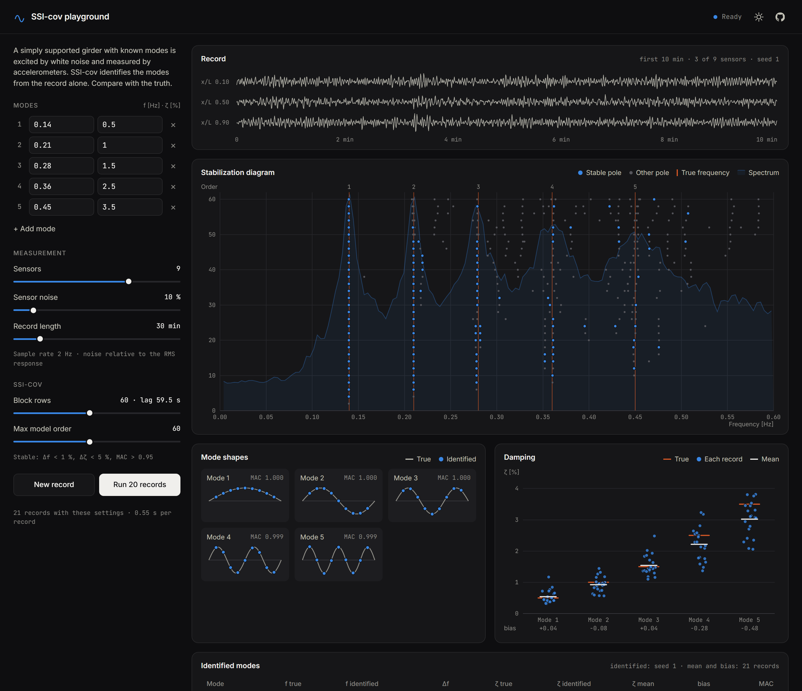

# SSI-cov playground

Covariance-driven stochastic subspace identification (SSI-cov), running in the browser.

**[Open the playground](https://hennindg.github.io/ssi-playground/)**



A simply supported girder with modes you choose (frequency and damping) is excited by white noise
and measured by a row of accelerometers. SSI-cov identifies the modes from the record alone, and
the page compares them with the truth: stabilization diagram, mode shapes, and the damping over
many records.

Things to try:

- **Block rows.** With more block rows (longer time lags) the damping of the heavily damped modes
  is underestimated more. Run 20 records at 30 and at 120 block rows and compare the bias.
- **Record length.** The bias shrinks for longer records; it is a finite-record effect.
- **Close modes, few sensors.** Put two modes 2 % apart and reduce the sensors.
- **Noise.** At high sensor noise the weakly excited columns in the stabilization diagram break up.

## How it works

| Step | |
|---|---|
| Simulation | Each mode is a single-degree-of-freedom oscillator with its own white-noise force, discretized exactly (zero-order hold) and started from its stationary state, so the true frequency and damping are known exactly. Mode *k* has *k* half-waves, sin(kπx/L). All modes have the same response level; sensor noise is a fraction of the RMS response. Sample rate 2 Hz. |
| SSI-cov | Output covariances (via FFT) up to lag 2s−1, block Toeplitz matrix, U and S from the eigen-decomposition of T·Tᵀ, system matrix from the shift structure of the observability matrix, poles from its eigenvalues (Peeters & De Roeck, 1999). |
| Stability | A pole is stable when, compared with the previous model order, Δf < 1 %, Δζ < 5 % and MAC > 0.95. |
| Mode picking | Single-linkage clustering of the stable poles on Δf/f + (1 − MAC), cut at 0.05; a mode must appear at a quarter of the model orders. Damping outliers are removed with the box-plot rule. |

The computation is plain Python and numpy in [`python/ssi_core.py`](python/ssi_core.py), run in a
Web Worker by [Pyodide](https://pyodide.org). The page itself (`index.html`, `app.js`, `style.css`)
has no build step and no framework; the plots are hand-written SVG.

The SSI and clustering functions come from an
[operational modal analysis of the Hardanger Bridge](https://github.com/hennindg/hardanger-oma)
(1310 m main span, Norway), where the same damping bias showed up and had to be corrected.

## Run locally

```bash
python -m http.server 8000
```

Then open http://localhost:8000. Tests of the Python core:

```bash
python -m pytest
```

## Reference

Peeters, B. & De Roeck, G. (1999). Reference-based stochastic subspace identification for
output-only modal analysis. *Mechanical Systems and Signal Processing*, 13(6), 855–878.

## License

MIT
